# Slides de la sesión FNOL

Veintiocho diapositivas para unos 22 minutos de presentación: portada, agenda, cuatro separadores de sección, veintiuna diapositivas de contenido y cierre. Doce de ellas (14-25) presentan la capa de gobierno sección a sección; el plan está en [plan-slides-sesion-pilares.md](plan-slides-sesion-pilares.md). Cada diapositiva de contenido lleva título, contenido, fuentes y notas del ponente. Guion completo en [guion-sesion.md](guion-sesion.md).

Versión en PowerPoint (plantilla Logicalis 2026): [slides-sesion-v4.pptx](slides-sesion-v4.pptx). Se genera a partir de la v3 con `python3 _docs/build_slides_sesion_v4.py`, que rehace la slide 11, añade las slides 14-25 con las capturas de `img/observabilidad/` y actualiza «Vamos a verlo». Iconos de [Lucide](https://lucide.dev) (los mismos de `icons.js`), insertados como SVG editable. La [v3](slides-sesion-v3.pptx) se conserva porque es la base de la que parte el script.

| Nº | Diapositiva | Tipo |
|---|---|---|
| 1 | FNOL con agentes gobernados | Portada |
| 2 | Agenda | Agenda |
| 3 | 01 · El problema | Separador |
| 4 | La avalancha de avisos | Contenido |
| 5 | Clasificar ya está resuelto | Contenido |
| 6 | El problema real: de piloto a producción | Contenido |
| 7 | 02 · El marco normativo | Separador |
| 8 | Lo que exige la regulación | Contenido |
| 9 | 03 · La solución | Separador |
| 10 | Lo que no existe en el mercado | Contenido |
| 11 | La solución: agentes pequeños y gobernados | Contenido |
| 12 | Cada agente, inventariado | Contenido |
| 13 | Seis pilares, cada uno con su prueba | Contenido |
| 14 | Resumen: el estado del sistema en diez segundos | Contenido + captura |
| 15 | Trazabilidad: qué pasó con cada mensaje | Contenido + captura |
| 16 | Autonomía: cuánto decide cada agente solo | Contenido + captura |
| 17 | Guardrails: los límites que frenan al agente | Contenido + captura |
| 18 | Intervención humana: una supervisión demostrable | Contenido + captura |
| 19 | Razonamiento y replay: el porqué y el «¿y si…?» | Contenido + captura |
| 20 | Knowledge Bases: el conocimiento con el que deciden | Contenido + captura |
| 21 | Cumplimiento: la prueba en cada decisión | Contenido + captura |
| 22 | Seudonimizar antes de llamar al modelo | Contenido + captura |
| 23 | FinOps: el coste de cada decisión, bajo control | Contenido + captura |
| 24 | Medidas correctivas: cada problema con su dueño | Contenido + captura |
| 25 | Histórico: el libro de registro | Contenido + captura |
| 26 | 04 · La demo | Separador |
| 27 | Vamos a verlo | Contenido |
| 28 | Gracias | Cierre |

---

## 1 · Portada

**FNOL con agentes gobernados**
De la IA que clasifica a la IA que se puede poner en producción.
Presentado por Ignacio Sánchez.

> **Notas (0-1 min):** «Hoy no os voy a enseñar que la IA clasifica un siniestro. Eso ya lo sabéis. Os voy a enseñar cómo se pone en producción en una aseguradora.»

---

## 2 · Agenda

01 El problema · 02 El marco normativo · 03 La solución · 04 La demo

---

## 3 · Separador 01 · El problema

Millones de avisos que lee y teclea una persona, y una IA que no sale del piloto.

---

## 4 · La avalancha de avisos

Cinco cifras, cada una con su icono:

| Icono | Cifra | Descripción | Fuente |
|---|---|---|---|
| `car-front` | **~11 M** | siniestros de Auto al año en España | ¹ |
| `timer` | **1 cada 3 s** | ritmo al que el seguro atiende un percance en carretera | ¹ |
| `messages-square` | **5 canales** | email, WhatsApp, chat, formulario web y teléfono | (los que cubre la solución) |
| `calendar-clock` | **7 días** | plazo para comunicar el siniestro (art. 16 LCS) | ² |
| `coins` | **~10 %** | de la prima de Auto se va en gestionar siniestros (EE. UU., 2023) | ³ |

**Cada aviso hay que leerlo, clasificarlo por ramo, extraer los datos y aplicar las reglas de la póliza.**

Fuentes: ¹ [UNESPA, siniestros de automóvil (datos 2024)](https://www.unespa.es/notasdeprensa/siniestros-automovil-datos-2024/) · ² [Ley 50/1980 de Contrato de Seguro, art. 16 (BOE)](https://www.boe.es/buscar/act.php?id=BOE-A-1980-22501#a16) · ³ [Insurance Information Institute, Private Passenger Auto Underwriting Expenses (NAIC, 2023)](https://www.iii.org/table-archive/23229)

> **Notas (1-3 min):** «Cada mensaje lo lee, lo clasifica y lo teclea una persona. Ahí se va el tiempo y el dinero. Y el cliente espera respuesta en horas, no en días.»
>
> *Sobre el ~10 %: es el gasto de gestión de siniestros en Auto de particulares en EE. UU. en 2023 (2,3 % defensa y contención de costes + 7,5 % tramitación, sobre prima). No hay dato público equivalente para España. Sustituye al 10-12 % de versiones anteriores, que venía de una fuente secundaria que no lo respaldaba.*

---

## 5 · Clasificar ya está resuelto

Tres tarjetas:

- `target` **Más de un 90 % de acierto**: un prompt bien escrito clasifica por ramo y extrae los datos del aviso.
- `languages` **Con texto real, no de laboratorio**: entiende texto informal, faltas de ortografía y transcripciones telefónicas.
- `clock` **Se monta en una tarde**: un prompt base y un bloque de reglas por ramo. No hace falta entrenar ningún modelo.

`monitor` *En la demo: 51 mensajes de ejemplo de cinco canales (email, formulario web, chat, teléfono y WhatsApp) y tres ramos (Auto, Hogar y Salud).*

Banda roja: **Esto ya no diferencia a nadie.** La pregunta ya no es si la IA puede hacerlo, sino cómo se pone en producción en una aseguradora.

> **Notas (3-4 min):** Ir rápido. La idea es quitar de la mesa la pregunta «¿la IA puede hacerlo?» para pasar a la que importa.

---

## 6 · El problema real: de piloto a producción

| Icono | Cifra | Descripción | Fuente |
|---|---|---|---|
| `flask-conical` | **>90 %** | de las aseguradoras evalúa ya IA generativa | ¹ |
| `rocket` | **22 %** | la tiene en producción | ² |
| `bot` | **4 %** | tiene agentes en producción | ³ |
| `circle-x` | **>40 %** | de los proyectos agénticos se cancelarán antes de finales de 2027 | ⁴ |

**Por qué se cancelan, según Gartner:** `trending-up` costes que se disparan · `circle-help` valor de negocio poco claro · `shield-alert` controles de riesgo insuficientes.

**Tres preguntas sin respuesta:** ¿por qué decidió eso? ¿Quién lo controla? ¿Cuánto cuesta?

Fuentes: ¹ [Conning, AI in Insurance 2025](https://conning.com/about-us/news/ir-pr---ai-survey-2025) · ² [Outcome Catalyst, tendencias de IA en seguros 2026 (datos de Conning)](https://www.outcomecatalyst.com/blog/insurance-ai-data-trends-2026) · ³ [The Insurer, encuesta de IA Capital (2026)](https://www.theinsurer.com/ti/news/openai-dominates-ai-stacks-as-insurance-industry-moves-from-pilot-to-production-2026-05-06/) · ⁴ [Gartner, nota de prensa del 25/06/2025](https://www.gartner.com/en/newsroom/press-releases/2025-06-25-gartner-predicts-over-40-percent-of-agentic-ai-projects-will-be-canceled-by-end-of-2027)

> **Notas (4-6 min):** «Los proyectos no mueren porque la IA falle. Mueren porque nadie puede responder tres preguntas: ¿por qué decidió eso?, ¿quién lo controla?, ¿cuánto cuesta?» Estas tres preguntas son el hilo de toda la sesión.
>
> *Pendiente de verificar: el 4 % viene de un artículo de pago de The Insurer y no se ha podido contrastar en la fuente original. Una búsqueda atribuye a Celent que dos tercios de las aseguradoras ya tienen algún proyecto agéntico en producción, lo que lo contradice (informe no consultado). Confirmar antes de presentar o quitar la cifra.*

---

## 7 · Separador 02 · El marco normativo

Lo que ya obliga hoy (RGPD, DORA y EIOPA) y lo que llega con el AI Act.

---

## 8 · Lo que exige la regulación

**Ya en vigor** (seis tarjetas):

- `user-check` **RGPD art. 22**: derecho a no ser objeto de decisiones solo automatizadas. Según el TJUE (SCHUFA), firmar sin revisar no cuenta como intervención humana.
- `message-square-text` **RGPD art. 15**: derecho a una explicación con sentido de la lógica aplicada (TJUE, Dun & Bradstreet).
- `heart-pulse` **RGPD art. 9**: los datos de salud son categoría especial; afecta de lleno al ramo Salud.
- `server` **DORA**: los proveedores de LLM son terceros TIC: registro, riesgo de concentración y contratos.
- `landmark` **EIOPA (ago. 2025)**: gobierno de la IA proporcional al riesgo para todo uso de IA en seguros.
- `graduation-cap` **AI Act art. 4 y art. 50**: alfabetización en IA del personal y transparencia con quien interactúa con la IA.

**Lo que llega** (tres tarjetas con borde discontinuo):

- `scale` **AI Act · alto riesgo (Anexo III)**: obligaciones aplazadas al 2/12/2027 por el Digital Omnibus. El triaje de siniestros no está en el Anexo III.
- `gavel` **Ley Orgánica española de IA**: en el Congreso, con AESIA y la DGSFP como supervisoras.
- `badge-euro` **Sanciones**: hasta 35 M€ o el 7 % de la facturación global.

Línea de tiempo: **Hoy**: ya obligan el RGPD, DORA, EIOPA y los art. 4 y 50 del AI Act → **2/12/2027**: obligaciones de alto riesgo del AI Act.

Fuentes: [RGPD](https://eur-lex.europa.eu/eli/reg/2016/679/oj) · [TJUE C-634/21 (SCHUFA)](https://curia.europa.eu/juris/liste.jsf?num=C-634/21) · [TJUE C-203/22 (Dun & Bradstreet)](https://curia.europa.eu/juris/liste.jsf?num=C-203/22) · [DORA](https://eur-lex.europa.eu/eli/reg/2022/2554/oj) · [EIOPA, Opinion on AI governance (2025)](https://www.eiopa.europa.eu/eiopa-publishes-opinion-ai-governance-and-risk-management-2025-08-06_en) · [AI Act](https://eur-lex.europa.eu/eli/reg/2024/1689/oj) · [Digital Omnibus (Gibson Dunn)](https://www.gibsondunn.com/eu-ai-act-omnibus-agreement-postponed-high-risk-deadlines-and-other-key-changes/) · [Ley Orgánica de IA (Economist & Jurist)](https://www.economistjurist.es/zbloque-1/ley-organica-de-ia-espana-aterriza-el-ai-act-con-aesia-sanciones-y-sandboxes/)

> **Notas (6-9 min):** «Un humano que firma sin mirar no cuenta como supervisión: lo dijo el TJUE. Y el aplazamiento no es una excusa: quien construya sin gobierno ahora lo rehará en 2027.»
>
> *Cuidado: el triaje de siniestros no está en el Anexo III (solo la tarificación y evaluación de riesgo en Vida y Salud). No decir que el AI Act obliga hoy a todo esto; la obligación de hoy viene del RGPD, DORA y EIOPA.*

---

## 9 · Separador 03 · La solución

Agentes pequeños, cada uno con sus límites, sobre una capa de gobierno común.

---

## 10 · Lo que no existe en el mercado

**Hay piezas sueltas** (panel gris):

- `activity` **Observabilidad de LLM**: Langfuse, Arize o Datadog: trazas, latencia y tokens.
- `shield-check` **Plataformas de gobierno y riesgo de IA**: IBM watsonx.governance o Credo AI: inventario y políticas.
- `waypoints` **Estándar OpenTelemetry GenAI**: convenciones comunes para trazar llamadas a modelos.

`plug-zap` **Integración** (en el centro, uniendo los dos paneles)

**Nadie las une a tu negocio** (panel azul):

- `file-text` **Tu proceso de siniestros**: multicanalidad, clasificación, extracción y reglas, de punta a punta.
- `list-checks` **Tus reglas de negocio por ramo**: Auto, Hogar y Salud, con la evidencia de cada criterio.
- `calculator` **Tu contabilidad de costes**: coste por decisión y límites de gasto por agente.

Banda azul: **Esto no es un producto. Es cómo se trabaja hoy con IA en una empresa regulada.** No es una licencia: es una forma de implementar, integrada con el proceso, las reglas y los costes del cliente.

> **Notas (9-10 min):** No decir «no existe nada». Existen herramientas; lo que falta es integrarlas con el negocio del cliente. Si alguien pregunta «¿cuánto cuesta?», la respuesta es que es una forma de implementar, no una licencia.

---

## 11 · La solución: agentes pequeños y gobernados

Proceso en flechas:

1. `inbox` **Multicanalidad**: recibe y normaliza email, web, chat, teléfono y WhatsApp.
2. `tags` **Clasificación**: asigna Auto, Hogar o Salud citando los indicios del texto.
3. `scan-text` **Extracción**: convierte el texto libre en datos estructurados; nunca inventa.
4. `scale` **Reglas**: evalúa el bloque de reglas del ramo y propone la decisión.
5. `user-round-check` **Aprobado / A revisar**: la IA prepara; la persona decide.

Encima de las flechas, el rótulo **«Lo que se gobierna: cuatro agentes especializados»**: los agentes son el objeto del gobierno, no una pieza de la capa.

**Capa de gobierno común a todos los agentes**, con las once secciones del panel en los cinco bloques del menú:

| Bloque | Secciones (icono) |
|---|---|
| Operación | `layout-dashboard` Resumen · `route` Trazabilidad |
| Control | `sliders-horizontal` Autonomía · `shield-check` Guardrails · `user-check` Intervención humana |
| Calidad | `brain` Razonamiento y replay · `book-open` Knowledge Bases |
| Cumplimiento y coste | `thermometer` Cumplimiento · `coins` FinOps |
| Mejora y auditoría | `wrench` Medidas correctivas · `history` Histórico |

**No es una IA que lo hace todo:** son cuatro especialistas, y cada uno tiene sus propios límites.

> **Notas (10-11 min):** «No es una IA que lo hace todo. Son cuatro especialistas, y cada uno tiene sus propios límites.» Arriba, lo que se gobierna: los cuatro agentes. Abajo, la capa de gobierno, con las mismas secciones y bloques que el menú del panel. Las vemos una a una en las slides siguientes.

---

## 12 · Cada agente, inventariado

Antes «Capa de gobierno: cada agente tiene». Es el inventario de agentes, lo que muestra la sección Agentes del panel; por eso Agentes no tiene slide propia en el bloque 14-25.

Cuatro tarjetas:

- `crosshair` **Una sola función**: recibir, clasificar, extraer o aplicar reglas; cada agente hace una cosa.
- `cpu` **Su modelo y su versión de prompt**: por ejemplo, gpt-5-nano con el prompt v3.1 en Clasificación. Cada cambio queda registrado.
- `gauge` **Su nivel de autonomía**: de L0 Manual a L3 Autónomo, ajustado agente a agente según sus resultados.
- `user-cog` **Un responsable y unos permisos**: el agente de Reglas puede proponer, pero no puede pagar ni rechazar.

**Niveles de autonomía** (escala en flechas, los mismos textos que la demo):

| Nivel | Qué significa |
|---|---|
| L0 · Manual | El agente solo sugiere; una persona decide y ejecuta. |
| L1 · Asistido | El agente propone; una persona confirma cada caso. |
| L2 · Supervisado | Decide dentro de los guardrails; fuera de ellos escala a humano. |
| L3 · Autónomo | Decide y ejecuta; solo se audita a posteriori. |

**La autonomía se gana con datos y se pierde con datos:** el agente de Reglas bajó de L3 a L2 al superar el 3 % de overrides.

> **Notas (11-12 min):** Es el inventario de agentes: función, modelo y versión de prompt, nivel de autonomía y responsable con permisos mínimos. Al final siempre hay un técnico de seguros: la IA prepara, la persona decide.

---

## 13 · Seis pilares, cada uno con su prueba

Cuadrícula de 3 × 2 tarjetas:

| Icono | Pilar | Cómo se consigue | Norma | Dónde se ve en la demo |
|---|---|---|---|---|
| `shield-check` | **Seguro por diseño** | Guardrails, kill switch, identidad y permisos por agente. Se puede parar un agente sin perder ningún mensaje | DORA · AI Act art. 15 | Gobierno › Guardrails, Resumen |
| `file-check` | **Compliance por defecto** | Cada decisión deja una traza completa: qué pasó, quién decidió y cuánto costó | AI Act art. 12 · RGPD art. 30 | Gobierno › Trazabilidad |
| `book-open-check` | **Auditable** | Libro de registro con quién, qué y cuándo. Se rellena solo, sin trabajo extra | EIOPA · AI Act art. 12 | Gobierno › Histórico |
| `lightbulb` | **Explicable** | Regla + evidencia textual y razonamiento y replay: si el cliente pregunta por qué, está su propia frase | RGPD art. 15 y 22 · AI Act art. 13 | Ficha del mensaje · Razonamiento y replay |
| `refresh-cw` | **Resiliente** | Reintentos, fallback a motor local y degradación de modelo: si la IA falla, el mensaje no se pierde | DORA | Triaje (origen «fallback»), G-07, G-08 |
| `piggy-bank` | **FinOps** | Caps, coste por decisión y comparativa de modelos: el más barato que mantiene la calidad | Solvencia II (gobierno) | Gobierno › FinOps |

> **Notas (12-13 min):** «Todo lo que voy a decir ahora lo vais a ver funcionando.» Seis pilares; en las slides siguientes, cada sección del panel con lo que hace y lo que gana el negocio.

---

Las doce slides siguientes tienen el mismo diseño: el bloque del menú y su posición («Control · 3 de 12»), **Qué hace** (técnico) con el icono de la sección, **Qué gana el negocio** con una cifra de la demo, las normas, dónde se ve en la demo y, a la derecha, la captura de la sección.

---

## 14 · Resumen: el estado del sistema en diez segundos

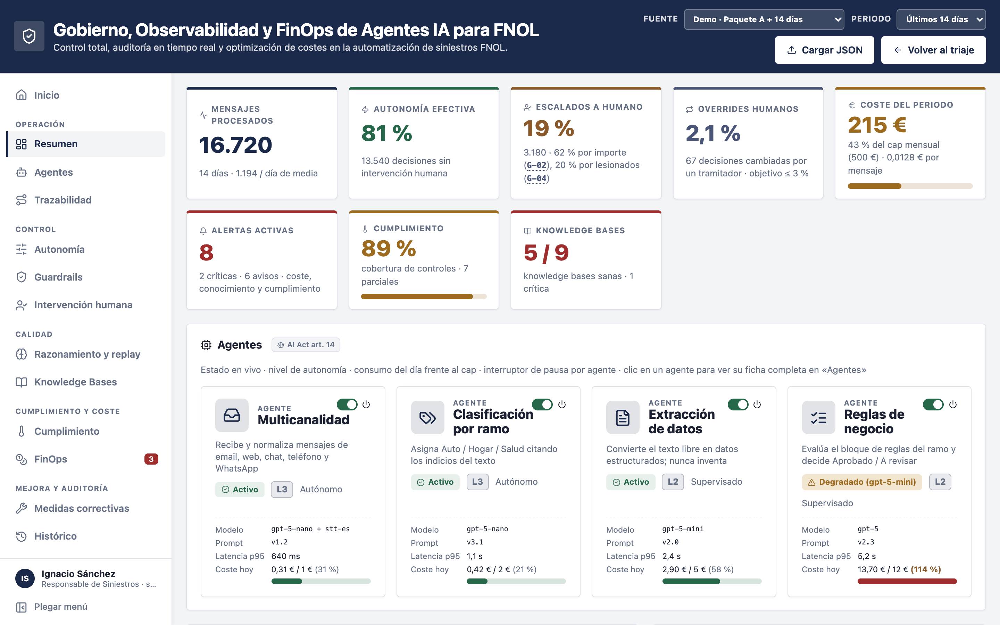

- **Bloque:** Operación · 1 de 12 · icono `layout-dashboard`
- **Qué hace:** Ocho indicadores en vivo: autonomía efectiva, escalados, overrides, coste frente al presupuesto, alertas, cumplimiento y conocimiento. Una tarjeta por agente con su modelo, su coste del día y un interruptor de pausa. Las alertas de coste, conocimiento y cumplimiento, cada una enlazada a su origen.
- **Qué gana el negocio:** Dirección sabe de un vistazo si el sistema va bien: el 81 % de las decisiones sale sin intervención humana y las personas corrigen el 2,1 %. Un agente se para desde aquí y sus mensajes esperan en cola: no se pierde ninguno.
- **Normas:** AI Act art. 14 · EIOPA
- **En la demo:** Gobierno › Resumen

> **Notas (13:00-13:40):** Es la pantalla de dirección. En la fila de arriba, los indicadores: el 81 % de las decisiones sale sola y las personas corrigen el 2,1 %, por debajo del objetivo del 3 %. Debajo, cada agente con su coste del día y su interruptor de pausa. A remarcar: se puede parar un agente sin perder ningún mensaje.

---

## 15 · Trazabilidad: qué pasó con cada mensaje

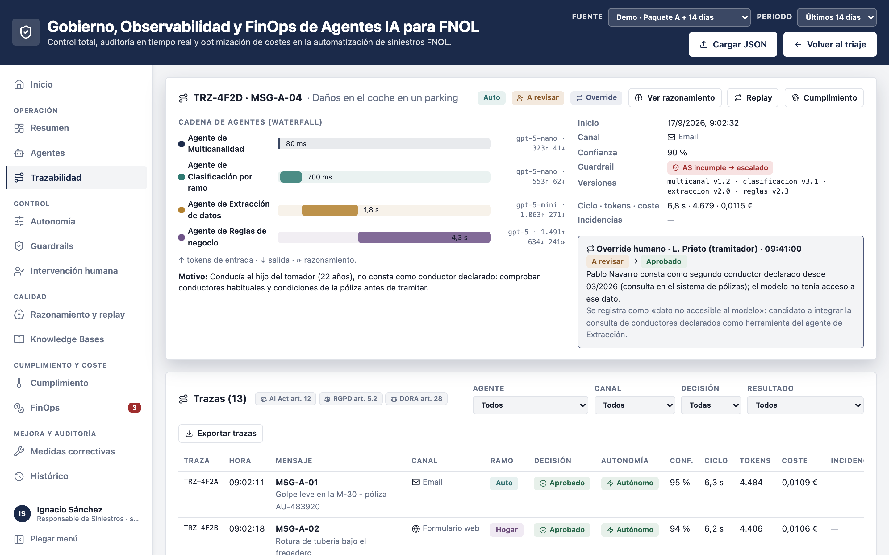

- **Bloque:** Operación · 2 de 12 · icono `route`
- **Qué hace:** Una traza por mensaje con la cascada de agentes: modelo, tokens, latencia y coste de cada paso. Registra el guardrail que saltó y la corrección humana, con quién, cuándo y por qué. Lista filtrable por agente, canal, decisión y resultado, exportable en JSON.
- **Qué gana el negocio:** Con un identificador se contesta al auditor o al reclamante: qué pasó, quién decidió y cuánto costó. En MSG-A-04 una persona corrigió al agente porque le faltaba un dato del sistema de pólizas, y la traza lo deja escrito.
- **Normas:** AI Act art. 12 · RGPD art. 5.2 y 30 · DORA art. 28
- **En la demo:** Gobierno › Trazabilidad

> **Notas (13:40-14:20):** La auditoría mensaje a mensaje. A la izquierda, cuánto tardó cada agente, con qué modelo y cuántos tokens. A la derecha, la corrección humana: el agente no veía los conductores declarados de la póliza. A remarcar: con un solo identificador se responde qué pasó, quién decidió y cuánto costó.

---

## 16 · Autonomía: cuánto decide cada agente solo

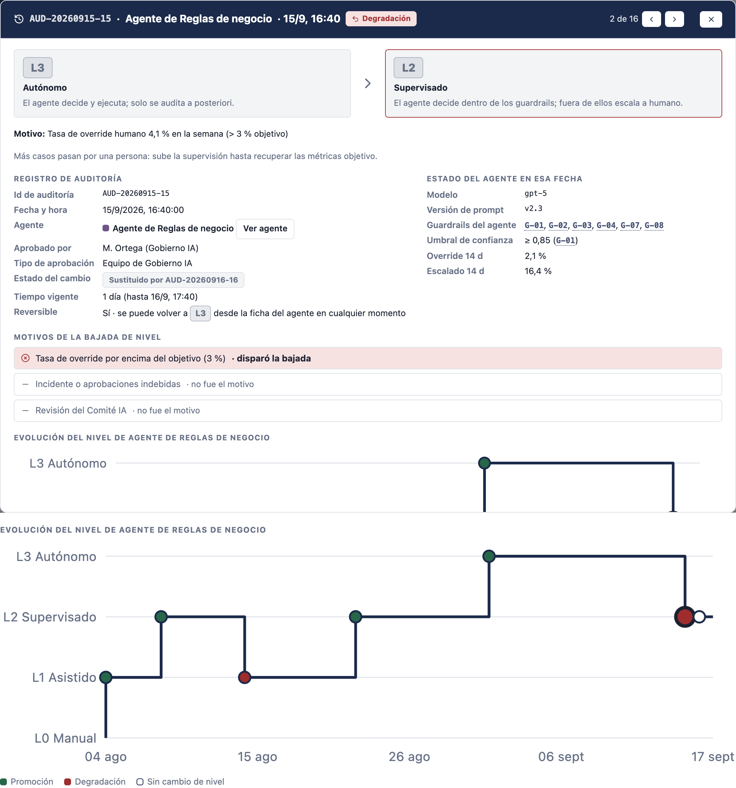

- **Bloque:** Control · 3 de 12 · icono `sliders-horizontal`
- **Qué hace:** Cuatro niveles por agente, de L0 Manual (solo sugiere) a L3 Autónomo (decide y ejecuta). Cada cambio de nivel queda auditado con su motivo, quién lo aprobó, la configuración del agente en ese momento y si es reversible.
- **Qué gana el negocio:** La autonomía se gana y se pierde con datos. El agente de Reglas bajó de L3 a L2 cuando su tasa de override llegó al 4,1 %, por encima del objetivo del 3 %.
- **Normas:** AI Act art. 14 · RGPD art. 22
- **En la demo:** Gobierno › Autonomía

> **Notas (14:20-15:00):** Arriba, el registro de la última bajada de nivel del agente de Reglas: el motivo, quién la aprobó y que es reversible. Abajo, la evolución de su nivel, con subidas en verde y bajadas en rojo. A remarcar: la autonomía es un resultado medido, nunca una decisión implícita.

---

## 17 · Guardrails: los límites que frenan al agente

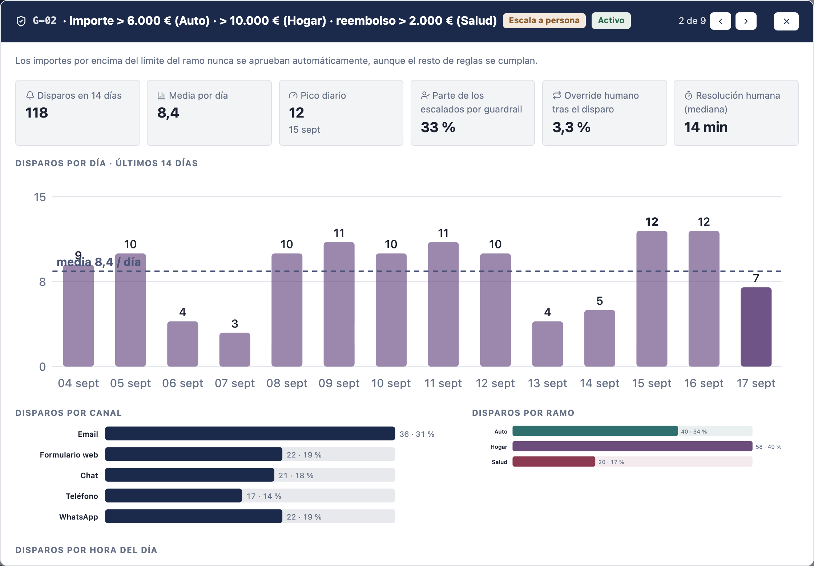

- **Bloque:** Control · 4 de 12 · icono `shield-check`
- **Qué hace:** Nueve condiciones: confianza baja, importe por encima del límite del ramo, ramos que no coinciden, lesionados, datos esenciales que faltan, coste y formato. Cada una escala a una persona, cambia a un modelo más barato o marca la traza. Antes de activar uno nuevo se ve cuántas veces habría saltado.
- **Qué gana el negocio:** Las reglas de la aseguradora mandan sobre el modelo. El guardrail de importe (G-02) saltó 118 veces en 14 días y explica el 62 % de los escalados.
- **Normas:** AI Act art. 9 y 14
- **En la demo:** Gobierno › Guardrails

> **Notas (15:00-15:40):** La ficha del guardrail de importe: 118 disparos en dos semanas, unas ocho al día, y en qué canal y ramo saltan. Los de importe y lesionados explican la mayoría de los escalados, y es lo esperado: son decisiones que no queremos que tome una máquina.

---

## 18 · Intervención humana: una supervisión demostrable

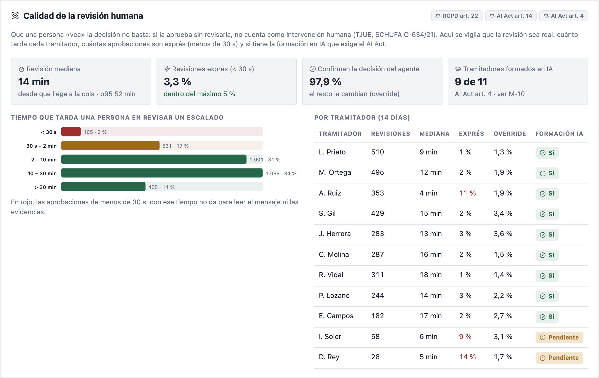

- **Bloque:** Control · 5 de 12 · icono `user-check`
- **Qué hace:** Cola de revisión con el motivo, el estado y el revisor de cada caso escalado. Mide cuánto tarda cada tramitador y cuántas aprobaciones se firman en menos de 30 segundos. Lleva la formación en IA de cada tramitador.
- **Qué gana el negocio:** 3.180 escalados en 14 días, revisados en una mediana de 14 minutos. El 3,3 % se aprueba en menos de 30 segundos y tres tramitadores pasan del máximo del 5 %: dos de ellos aún no tienen la formación en IA.
- **Normas:** RGPD art. 22 (SCHUFA) · AI Act art. 14 y 4
- **En la demo:** Gobierno › Intervención humana

> **Notas (15:40-16:20):** Volvemos a la sentencia SCHUFA de la slide 8: firmar sin revisar no cuenta como intervención humana. Aquí se mide. En la demo, la cola con cada caso escalado; en la captura, cuánto tarda cada tramitador: tres pasan del 5 % de aprobaciones exprés, y dos de ellos son los nuevos, sin la formación en IA.

---

## 19 · Razonamiento y replay: el porqué y el «¿y si…?»

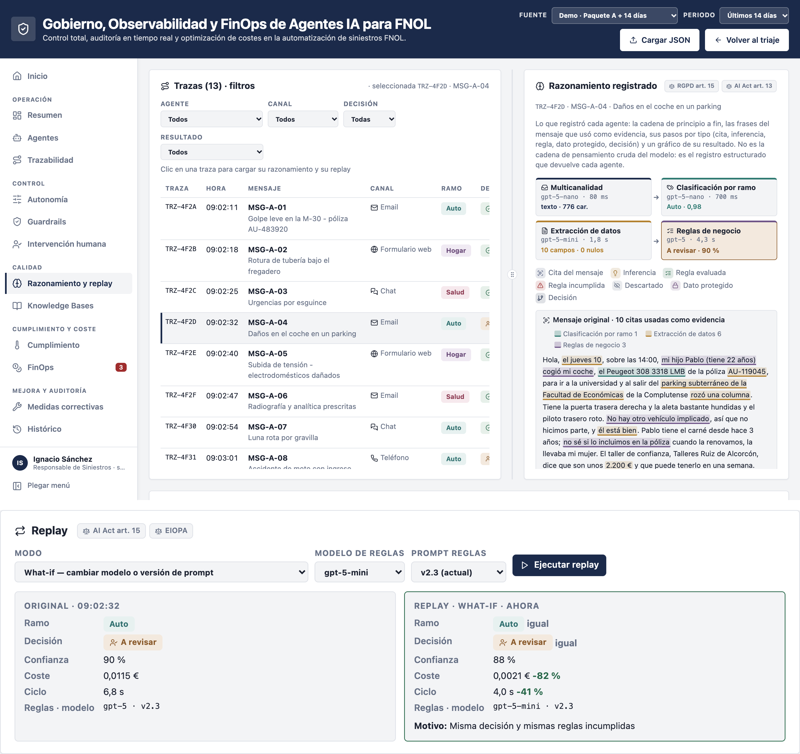

- **Bloque:** Calidad · 6 de 12 · icono `brain`
- **Qué hace:** El razonamiento registrado de cada agente: qué recibió, qué pasos siguió y qué devolvió. El replay repite cualquier traza con los mismos prompts y modelos, o con otro modelo o versión de prompt, y compara decisión, coste y latencia.
- **Qué gana el negocio:** Un cambio de modelo se decide con datos. Con gpt-5-mini en Reglas la decisión fue la misma y el coste bajó un 82 % (RP-0006). Con gpt-5-nano un Aprobado pasó a A revisar (RP-0005), y se vio antes de desplegar.
- **Normas:** RGPD art. 15 · AI Act art. 15
- **En la demo:** Gobierno › Razonamiento y replay

> **Notas (16:20-17:00):** Arriba, el razonamiento de cada agente tal como quedó registrado: es el registro estructurado que devuelve el agente, no su pensamiento interno. Abajo, el replay con un modelo más pequeño: misma decisión y un 82 % menos de coste. A remarcar: un cambio de modelo, que suele dar miedo, pasa a ser una decisión con datos.

---

## 20 · Knowledge Bases: el conocimiento con el que deciden

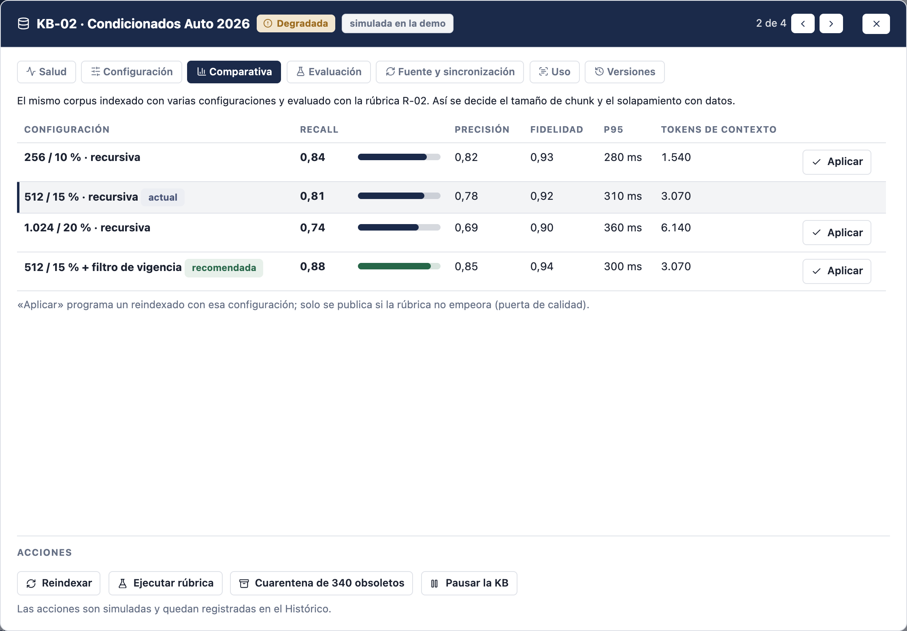

- **Bloque:** Calidad · 7 de 12 · icono `book-open`
- **Qué hace:** Inventario de las nueve bases que consultan los agentes: índices RAG, Markdown, runbooks, tablas y plantillas. Salud medida contra umbrales (recall, fidelidad, frescura, duplicados, datos personales), comparativa de configuraciones y rúbricas versionadas que deciden si un reindexado se publica.
- **Qué gana el negocio:** El conocimiento envejece y se vigila como los agentes. 340 condicionados de 2024 bajaron el recall de Condicionados Auto a 0,81; con un filtro de vigencia vuelve a 0,88.
- **Normas:** AI Act art. 10 · RGPD art. 17
- **En la demo:** Gobierno › Knowledge Bases

> **Notas (17:00-17:40):** Un agente puede estar bien y equivocarse porque consulta conocimiento degradado. En el ejemplo, alguien sincronizó condicionados de 2024 y el recall cayó. La comparativa prueba varias configuraciones sobre el mismo corpus y la recomendada lo arregla. A remarcar: cada traza dice qué versión de cada base usó.

---

## 21 · Cumplimiento: la prueba en cada decisión

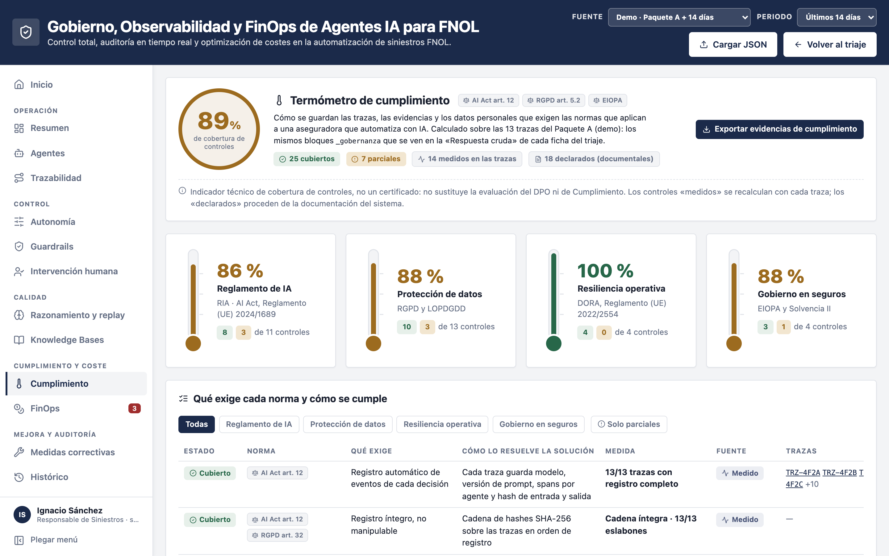

- **Bloque:** Cumplimiento y coste · 8 de 12 · icono `thermometer`
- **Qué hace:** Cada decisión lleva un bloque _gobernanza que calcula la plataforma: datos personales detectados, por qué este ramo y no otro, sello SHA-256 encadenado y plazo de retención. El termómetro agrega esos bloques por marco (AI Act, RGPD, DORA, EIOPA) y separa los controles medidos en las trazas de los declarados.
- **Qué gana el negocio:** El DPO tiene la evidencia recalculada con cada traza: 89 % de cobertura, con los controles en ámbar a la vista (EIPD pendiente, aviso de IA en WhatsApp). Si alguien altera un registro, la cadena de hashes se rompe y se ve.
- **Normas:** RGPD art. 5.1.c, 9 y 22 · AI Act art. 12 · DORA · EIOPA
- **En la demo:** Gobierno › Cumplimiento

> **Notas (17:40-18:20):** El modelo no se autocertifica: el bloque de gobierno lo calcula la plataforma en cada decisión. El termómetro lo agrega por marco. Hay controles en ámbar y eso da credibilidad: un 100 % no se lo cree nadie. A remarcar: es la evidencia que necesita el DPO, no un certificado.

---

## 22 · Seudonimizar antes de llamar al modelo

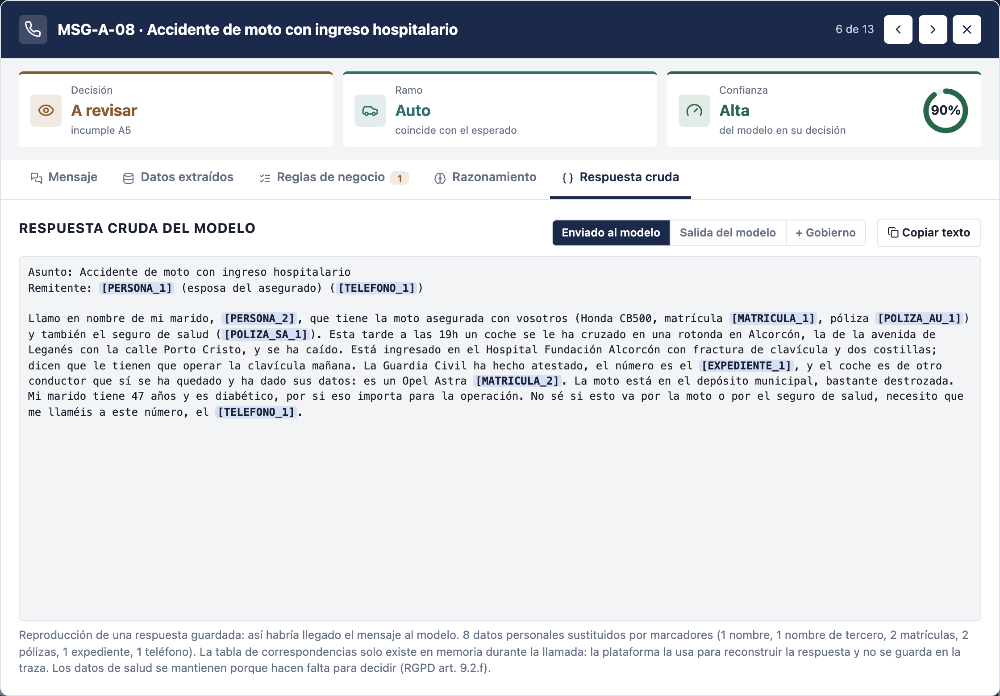

- **Bloque:** Cumplimiento y coste · 9 de 12 · icono `eye-off`
- **Qué hace:** Antes de llamar al modelo, nombres, DNI, teléfonos, IBAN, pólizas, matrículas y direcciones se cambian por marcadores como [PERSONA_1] o [POLIZA_AU_1]. Los datos de salud y la edad de los menores se mantienen porque hacen falta para decidir. La tabla de correspondencias solo vive en memoria durante la llamada.
- **Qué gana el negocio:** En MSG-A-08 llegan al modelo 8 marcadores en lugar de los datos reales, y el tramitador ve la ficha de siempre. La traza guarda qué tipos se sustituyeron y el hash del texto enviado, y el control de minimización pasa a verde.
- **Normas:** RGPD art. 5.1.c, 9, 25 y 32
- **En la demo:** Triaje › Respuesta cruda › Enviado al modelo

> **Notas (18:20-19:00):** Es la respuesta al RGPD art. 9 de la slide 8. El modelo no necesita el nombre ni el DNI del asegurado para decidir, así que no los recibe. La fractura y la diabetes sí viajan, porque hacen falta para decidir. Al volver la respuesta, la plataforma pone los valores reales y el tramitador ve la ficha de siempre.

---

## 23 · FinOps: el coste de cada decisión, bajo control

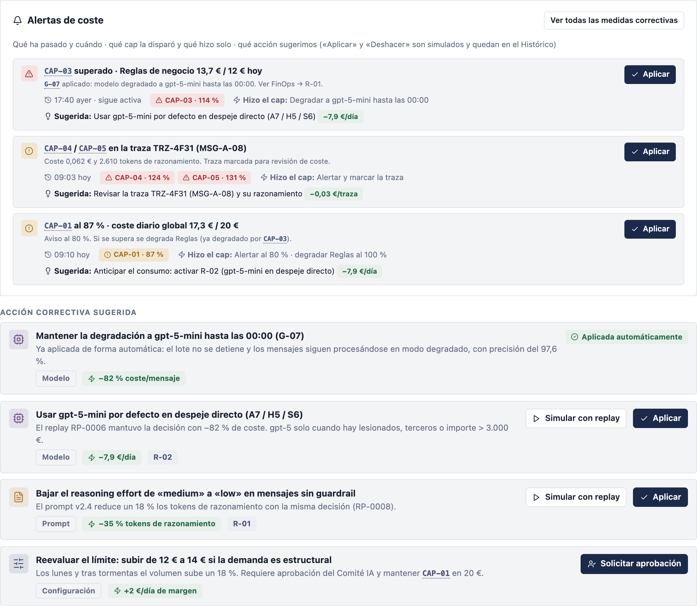

- **Bloque:** Cumplimiento y coste · 10 de 12 · icono `coins`
- **Qué hace:** Límites de gasto a cinco niveles: global, por agente, por traza, por tokens de razonamiento y por llamadas por minuto. Avisan al 80 % y actúan al 100 %. Cada alerta llega con la acción sugerida y su ahorro, y una comparativa de modelos dice cuál conviene a cada agente.
- **Qué gana el negocio:** El agente de Reglas se lleva el 79 % del gasto. Al superar su límite diario (114 %) pasó solo a un modelo más barato, sin parar el proceso. El mes cerrará en 428 € de un presupuesto de 500 €.
- **Normas:** Solvencia II art. 41
- **En la demo:** Gobierno › FinOps

> **Notas (19:00-19:40):** Arriba, las alertas de coste: qué pasó, qué límite saltó, qué hizo el sistema solo y qué acción sugiere, con su ahorro. Abajo, las acciones para el límite del agente de Reglas: unas se simulan con replay antes de aplicarlas y las de presupuesto las aprueba el comité. A remarcar: sabemos lo que cuesta cada decisión.

---

## 24 · Medidas correctivas: cada problema con su dueño

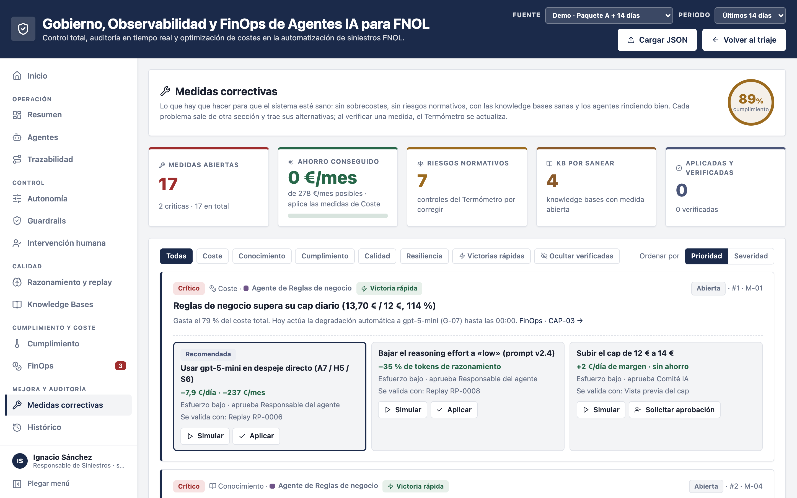

- **Bloque:** Mejora y auditoría · 11 de 12 · icono `wrench`
- **Qué hace:** Una lista de trabajo con los problemas que detecta el resto del panel: coste, conocimiento, cumplimiento, calidad y resiliencia. Cada uno trae alternativas con su impacto, su efecto secundario, su esfuerzo, quién la aprueba y cómo se valida, ordenadas por severidad × impacto ÷ esfuerzo.
- **Qué gana el negocio:** Aplicar M-01 (gpt-5-mini en los casos sencillos) ahorra 237 € al mes. Verificar una medida de cumplimiento pone su control en verde en el termómetro.
- **Normas:** AI Act art. 9 · EIOPA
- **En la demo:** Gobierno › Medidas correctivas

> **Notas (19:40-20:20):** Ver los problemas no basta: hay que cerrarlos. Esta sección junta en una lista todo lo que el resto del panel detecta, con varias alternativas por problema. Arriba quedan las victorias rápidas. A remarcar: el gobierno se cierra cuando cada problema tiene dueño, alternativa y verificación.

---

## 25 · Histórico: el libro de registro

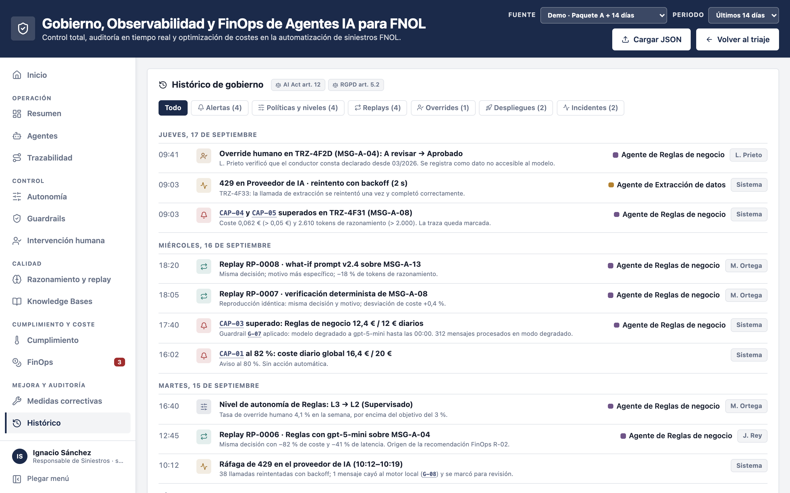

- **Bloque:** Mejora y auditoría · 12 de 12 · icono `history`
- **Qué hace:** Una línea de tiempo con alertas, cambios de políticas y de nivel, replays, overrides, despliegues, incidentes y operaciones. Cada evento lleva fecha, agente, motivo y responsable, también lo que se hace en directo, como pausar un agente o apagar un guardrail.
- **Qué gana el negocio:** Cuando llega un auditor, la evidencia ya está: qué cambió, cuándo, por qué y quién lo aprobó. Se rellena sola, sin trabajo extra del equipo.
- **Normas:** AI Act art. 12 · EIOPA
- **En la demo:** Gobierno › Histórico

> **Notas (20:20-21:00):** Todo lo anterior deja rastro aquí, con fecha, agente, motivo y responsable. En la demo, lo que toquemos en directo aparecerá como «Operador (esta sesión)». A remarcar: es el libro de registro que pide el regulador y se rellena solo.

---

## 26 · Separador 04 · La demo

Lo que ve el tramitador y lo que ven riesgos, auditoría y finanzas.

---

## 27 · Vamos a verlo

Dos tarjetas, cada una con una captura real de la demo (Paquete A en «Resultados guardados»):

| | `headset` **Triaje FNOL** | `landmark` **Gobierno de Agentes** |
|---|---|---|
| Público | Lo que ve el tramitador | Lo que ven riesgos, auditoría y finanzas |
| Captura | Triaje con el lote procesado: 10 aprobados, 3 a revisar | Gobierno › Resumen: KPIs, agentes y coste frente al cap |
| Pregunta | ¿Qué hace el sistema con cada aviso? | ¿Podemos fiarnos, controlarlo y pagarlo? |
| Se verá | Un lote en vivo: ramo, datos y decisión en segundos · El criterio que falla y la frase del cliente que lo prueba · Reglas de negocio que se cambian sin programar | Autonomía, guardrails y revisión humana · Trazas, razonamiento y replay what-if · Conocimiento, cumplimiento, FinOps y medidas |

> **Notas (21-22 min):** «Primero lo que ve el tramitador. Después lo que ve el auditor y el CFO.» Cambiar a la demo con el motor en «Resultados guardados» y el Paquete A seleccionado.

---

## 28 · Gracias

Contraportada con www.logicalis.com.
